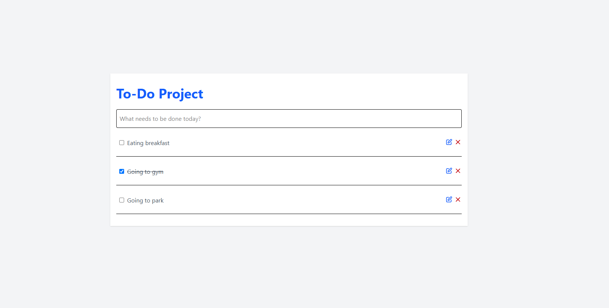

# 📝 React & TypeScript Todo App

> A clean, responsive, and type-safe Task Management web application built with **React 19**, **TypeScript**, and **Tailwind CSS**.


---

## 📖 About This Project

This project is a modern Todo application created primarily to practice and strengthen my skills in **React architecture**, **strict TypeScript typing**, and global state management using the **React Context API**.

> 💡 **Note on Styling:**  
> My main focus in this project was building the logic, TypeScript types, and React components. Since I haven't mastered **Tailwind CSS** yet, the UI styling and layout were adapted and borrowed from an existing project/template to provide a clean look while I focused on the core functionality.

All tasks are automatically synchronized with the browser's **Local Storage**, ensuring data persists across reloads.

---

## ✨ Features

- ➕ **Add Tasks** — Quickly add new tasks by pressing the `Enter` key.
- ✏️ **Edit & Update** — Inline editing capability for task titles.
- ✔️ **Toggle Completion** — Mark tasks as completed or pending with immediate visual feedback.
- 🗑️ **Delete Tasks** — Remove completed or unwanted tasks from the list.
- 💾 **Local Storage Persistence** — Tasks persist across sessions and page reloads.
- ⚡ **Global State Management** — Powered by React Context API and custom hooks for clean code separation.
- 🎨 **Pre-styled UI** — Clean interface using adapted Tailwind CSS classes.

---

## 🛠 Tech Stack

| Technology | Purpose | Status |
|------------|---------|--------|
| **React 19** | Component-driven UI & logic | ✅ Implemented |
| **TypeScript** | Type safety, interfaces & contracts | ✅ Implemented |
| **Context API** | Centralized global state management | ✅ Implemented |
| **UUID** | Unique ID generation for tasks | ✅ Implemented |
| **Vite** | Fast frontend tooling & bundler | ✅ Active |
| **Tailwind CSS** | Styling & UI layout | 📦 Borrowed template |

---

## 📂 Project Structure
```text
src/
├── assets/          # Icons and visual assets
├── components/
│   ├── MainTodo.tsx     # Main container & layout
│   ├── TodoList.tsx     # Renders list of tasks
│   ├── TodoItem.tsx     # Single task item display
│   ├── EditTodo.tsx     # Task edit action & input
│   ├── DeleteTodo.tsx   # Task deletion trigger
│   └── NewContext.tsx   # Context API provider & task handlers
├── App.tsx          # Root component wrapped with Provider
└── main.tsx         # Application entry point
```
## 🚦 Roadmap & Future Enhancements

- [x] Complete task CRUD operations (Create, Read, Update, Delete)
- [x] Integrate LocalStorage for data persistence
- [x] Strict TypeScript typing for Context & event handlers
- [ ] Learn Tailwind CSS thoroughly to write custom designs from scratch
- [ ] Add filtering options (All, Active, Completed)
- [ ] Dark / Light mode toggle

---

## 🖥 How to Run Locally

### 1. Clone the repository
```bash
git clone https://github.com/your-username/your-repo-name.git
cd your-repo-name
```
### 2. Install dependencies
```bash
npm install
```

### 3. Start development server
```bash
npm run dev
```

Open [http://localhost:5173](http://localhost:5173) in your browser to view the app!

---

## 📜 License
This project is open source and available under the [MIT License](LICENSE).
`
